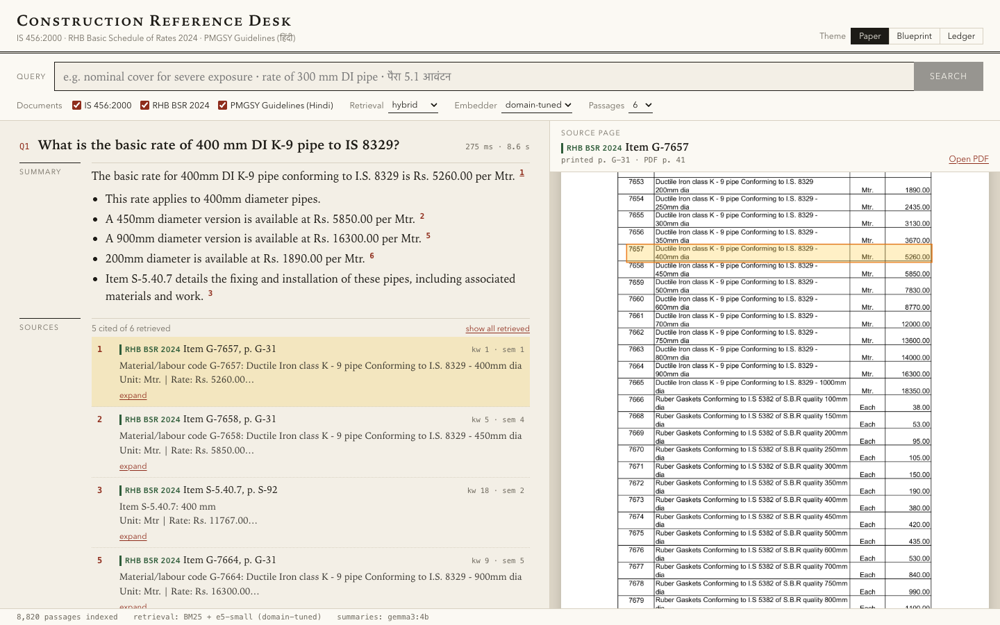
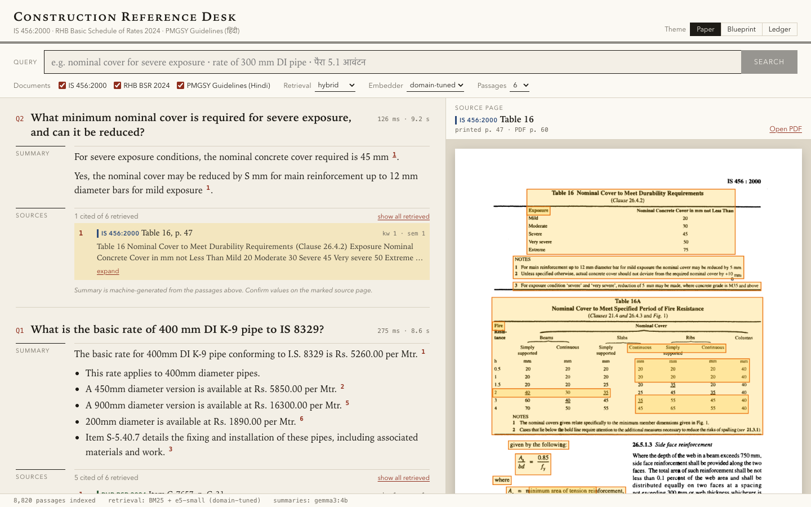
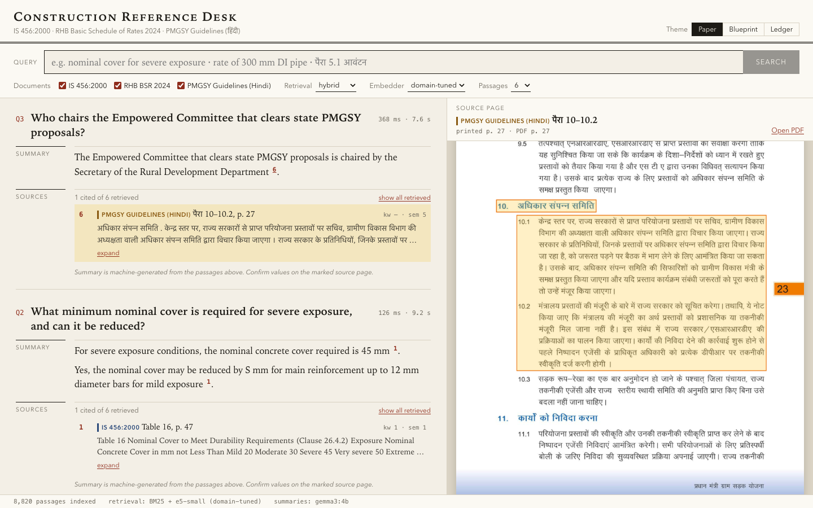
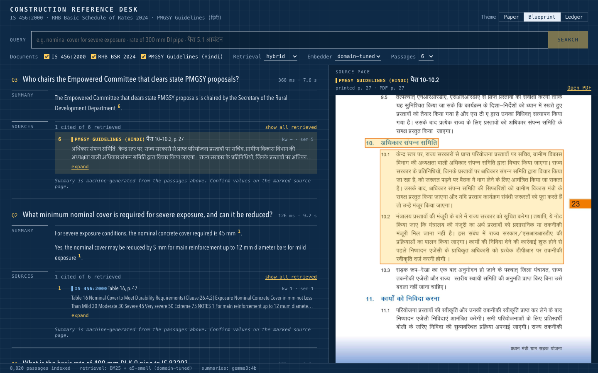
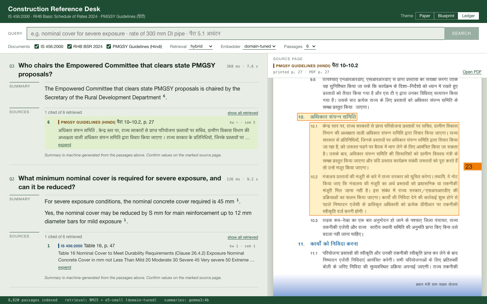

# Construction RAG

A question-answering system over three Indian construction documents, with citations back to the
source page. FastAPI backend, React frontend, runs locally.

Documents used:

- **IS 456:2000** (Plain & Reinforced Concrete, Code of Practice, 114 pages) — a scanned English
  standard. The text layer that came with the PDF is bad OCR (`ThisIndianStandard`, `Nominal
  Cencrete Cover`), so it's re-OCR'd.
- **RHB Basic Schedule of Rates 2024** (824 pages) — a born-digital rate schedule, 8,000+ rows, no
  table borders. A row like `1.5.2 exceeding 80mm dia … 161.00` only makes sense with its parent
  item, which is often on the previous page.
- **PMGSY Guidelines** (Hindi, 46 pages) — an image-only scan, no text layer at all. OCR'd in
  Hindi, with the margin paragraph numbers repaired since Tesseract reads them badly (`5.1` → `54`).

Every answer cites numbered sources, and clicking a citation opens the source page with the exact
passage marked.



## Setup

You need Python 3.11+, Node 18+, and [Ollama](https://ollama.com) for the local LLM.

```bash
# copy the three PDFs into data/pdfs/ (or set CORPUS_DIR to wherever they are)
cp /path/to/corpus/{IS456-2000_concrete-code_EN,RHB-BSR-2024_schedule-of-rates_EN,PMGSY-III-guidelines_HINDI_image-only-scan}.pdf data/pdfs/

python3.11 -m venv .venv && .venv/bin/pip install -r backend/requirements.txt
cd backend
../.venv/bin/python -m rag.ingest      # parse PDFs → chunks, ~10s (OCR is cached in the repo)
../.venv/bin/uvicorn rag.api:app --port 8765

# separate terminal
ollama serve & ollama pull gemma3:4b

# separate terminal
cd frontend && npm install && npm run dev   # → http://localhost:5173
```

That's enough to run the app — it uses the base embedding model until you fine-tune one. To do
that:

```bash
../.venv/bin/python -m finetune.build_dataset   # build training pairs, ~1 min
../.venv/bin/python -m finetune.train           # fine-tune the retriever, ~25 min on an M-series Mac
../.venv/bin/python -m finetune.interpolate     # blend it with the base model, pick the blend on held-out data
```

There's a Makefile too: `make setup ingest dataset train interpolate eval api ui`, and
`make ask Q="…"` for a one-off question from the terminal.

### Asking a question

In the UI, type a question in English or Hindi, or click a sample query. You can restrict which
documents get searched, switch between hybrid/semantic/keyword retrieval, and compare the base vs.
fine-tuned embedder. Click any citation number to see the source page.

From the CLI:

```bash
cd backend
../.venv/bin/python -m rag.cli "What minimum nominal cover is required for severe exposure?"
../.venv/bin/python -m rag.cli --docs bsr "rate of 400 mm DI K-9 pipe to IS 8329"
../.venv/bin/python -m rag.cli --search-only "PMGSY maintenance contract"   # no LLM, just retrieval
```

Or hit the API directly — `POST /api/ask` streams NDJSON (sources, then answer tokens, then which
sources got cited):

```bash
curl -N localhost:8765/api/ask -H 'content-type: application/json' \
     -d '{"question": "Who chairs the Empowered Committee that clears state PMGSY proposals?"}'
```

### Which LLM

Generation goes through any OpenAI-compatible endpoint. Default is Ollama running `gemma3:4b`,
mostly because it's small enough to run locally and still handles Hindi reasonably.

| Variable | Default | |
|---|---|---|
| `LLM_BACKEND` | `auto` | `openai`, `anthropic`, `none` (no LLM, just returns passages), or `auto` |
| `OPENAI_BASE_URL` / `LLM_MODEL` | `http://localhost:11434/v1` / `gemma3:4b` | any OpenAI-compatible server |
| `ANTHROPIC_API_KEY` / `ANTHROPIC_MODEL` | — / `claude-haiku-4-5` | used automatically if the key is set |
| `EMBED_MODEL` | `finetuned` | `finetuned`, `base`, or any HF model id |
| `BM25_WEIGHT` | `0.25` | how much weight keyword search gets in the fused ranking |
| `CORPUS_DIR` | `data/pdfs` | where the PDFs live |

## How it works

```
PDF → parser (per document type) → chunks with citations + highlight boxes
                    │
        BM25  +  multilingual-e5-small (fine-tuned)
                    │ weighted rank fusion
                   top-k
                    │
        LLM with numbered sources → answer with [n] citations
```

### Parsing

Each document gets its own parser, because "split the text every 500 tokens" doesn't work on any
of these.

**BSR (`bsr.py`)** — reads word positions from PyMuPDF, works out each page's column boundaries
from its header row, and rebuilds rows from that. Item codes are hierarchical (`1.8` → `1.8.2` →
`1.8.2.1`), so every rate row is stored with its full parent chain, distinguishing text first:

```
Item B-1.8.3.2: HARD ROCK (BLASTING PROHIBITED) … › exceeding 80mm dia but not exceeding 300mm dia.
Unit: Mtr. | Rate: Rs. 864.00
Under: Excavating trenches of required width for pipes cables etc. …
Section: Building Work › Earth Work
```

Parents get resolved by code prefix even across a page break. PyMuPDF's built-in table extractor
doesn't work here — there are no ruling lines, so it just merges the whole page into one cell.

**IS 456 (`is456.py`)** — the existing text layer is bad OCR, so it's redone with Tesseract, which
is much better except it interleaves the two text columns. The fix splits lines at the gap in the
middle of the page and reads left column first, right column second, except for lines that
actually span both columns (headings, some table rows). Chunks follow clause boundaries and cite
the printed page number, not the PDF page number.

**PMGSY (`pmgsy.py`)** — no text layer, so this is OCR from scratch (Tesseract, Hindi + English).
Body text comes out clean; the paragraph numbers in the margin don't (the Hindi model reads `1` as
`4`, so `5.1` becomes `54`). Each margin number gets re-read with an English-only model and checked
against the expected sequence, which gets a clean `1, 1.1, 1.2, … 22.2`.

One side note: the corpus also has a "selectable-text" PMGSY summary PDF, but its font mapping is
broken and copying text from it drops letters (`प्रधानमंत्री` becomes `धानमंी`). Selectable isn't
the same as usable — that one would need OCR too.

OCR output is cached in the repo (`data/processed/ocr/`). To redo it: install Tesseract, download
the `tessdata_best` language files, delete the cache, and re-run `rag.ingest`.

### Retrieval

BM25 and a dense embedding model (`multilingual-e5-small`) run in parallel and get combined with
weighted reciprocal rank fusion. Both matter: BM25 is unbeatable for exact tokens like `300mm` or
`IS 8329`, and the dense model is the only thing that can connect an English question to the Hindi
document. Plain (unweighted) fusion turned out worse than dense search alone, because BM25's
English matches drown out the right Hindi passage — so BM25 gets a lower weight, tuned on held-out
data. An exact BSR item code in the question (`B-1.5.2`) skips search and gets pinned to the top.

### Answering

The LLM gets numbered source passages and has to cite every factual claim, quote rates/units/clause
numbers exactly, answer in the question's language, and say so if the sources don't cover the
question. Citations in the UI open the source page with the relevant region highlighted, using
boxes saved at parse time.

| IS 456 table (re-OCR'd scan) | English question → Hindi scan |
|---|---|
|  |  |

The UI is built to look like a reference tool rather than a chat window — a search bar, a numbered
query log, sources listed as footnotes. Three themes: Paper, Blueprint, Ledger.

| Blueprint | Ledger |
|---|---|
|  |  |

## Fine-tuning

The part that's fine-tuned is the retriever's embedding model (`multilingual-e5-small`), not the
LLM. Reasoning: if the right passage isn't retrieved, nothing downstream can fix it — the LLM can
only cite what it's given. Once the right passage is in front of it, a small off-the-shelf model
can quote a number correctly without any training. The evaluation below also shows exactly where
retrieval was failing (English questions about the Hindi document, and near-identical BSR rows), so
it was clear what to fix.

A 118M-parameter encoder also fits in a day on a laptop. Fine-tuning the LLM would need actual
answer data, which didn't exist, and would take much longer to train and evaluate credibly.

No labelled data existed, so it's synthetic:

- **IS 456**: ~340 questions written by `gemma3:4b` per chunk, plus ~180 clause/table headings used
  as queries for chunks the LLM didn't get to.
- **PMGSY (Hindi)**: ~120 English + ~60 Hindi questions, written per paragraph, specifically to
  teach the cross-lingual match.
- **BSR**: ~2,400 template queries built from the parsed fields (sub-heading, size, unit), since the
  LLM was too slow on a laptop to cover 8,000+ rows — something like `rcc intze type over head
  service reservoir 250kl rate`.

For each question, a hard negative is mined from the base model's own top results — usually a
sibling row for BSR, which is exactly the distinction it needs to learn. The 50 gold chunks used in
the hand-written eval set are excluded from training, and 15% of the LLM-covered chunks are held
out as a separate synthetic test set. Total: 3,794 triplets, one epoch of Multiple-Negatives
Ranking loss, about 25 minutes on an M4 Mac.

### What actually happened

Training on its own was a mixed result. On the held-out synthetic questions it clearly helped
(BSR recall@5 went from 0.85 to 0.95), and it fixed the exact problem it was meant to fix — a
400mm pipe query that used to return the wrong row now returns the right one first. But on the
hand-written test set, top-1 accuracy got *worse* (0.72 → 0.57). Looking at the failures, the
model had started over-weighting bare numbers: a question about "40 m³ of concrete" was pulling up
BSR rows about "40 mm thick" because they share a number.

The fix was weight-space interpolation — averaging the fine-tuned weights with the base model's
weights, rather than using the fine-tuned model outright. This is sometimes called WiSE-FT. It
keeps most of the gain from fine-tuning while getting back the base model's general judgment. The
blend ratio was picked on the synthetic held-out set only (a 50/50 blend won there); the
hand-written set would have preferred a lighter blend, but tuning on the actual test set would
make its numbers meaningless, so 50/50 is what's shipped.

Full numbers, two test sets — 47 hand-written questions (never used in training) and 150 synthetic
held-out questions:

| Retriever | Hand-written R@1 | R@5 | R@10 | MRR@10 | Synthetic R@5 | MRR@10 |
|---|---|---|---|---|---|---|
| BM25 only | 0.62 | 0.70 | 0.77 | 0.66 | 0.81 | 0.68 |
| Dense, base model | 0.72 | 0.91 | 0.96 | 0.80 | 0.84 | 0.68 |
| Hybrid, base model | 0.66 | 0.87 | 0.94 | 0.75 | 0.85 | 0.72 |
| Dense, fine-tuned (no blending) | 0.57 | 0.94 | 0.96 | 0.74 | 0.92 | 0.76 |
| Dense, fine-tuned + blended | 0.72 | 0.94 | 0.98 | 0.82 | 0.90 | 0.77 |
| Hybrid, fine-tuned + blended (what's shipped) | 0.68 | 0.96 | 0.98 | 0.79 | 0.91 | 0.77 |

Full detail, including per-question ranks, is in [`eval/results.md`](eval/results.md).

By document type, recall@5 (base dense model → shipped config):

| | Hand-written | Synthetic |
|---|---|---|
| IS 456 | 0.94 → 1.00 | 0.84 → 0.90 |
| BSR | 0.94 → 1.00 | 0.85 → 0.98 |
| PMGSY, English question | 0.80 → 0.80 | 0.71 → 0.64 |
| PMGSY, Hindi question | 1.00 → 1.00 | 1.00 → 1.00 |

English-to-Hindi retrieval barely moved. It's also the slice with the least training data — the
LLM only got through about 70 of 101 Hindi paragraphs before generation was cut off.

### End to end

With the full pipeline (retrieval + `gemma3:4b` generating the answer), on the 47 hand-written
questions: the right passage reached the LLM 45/47 times, 37/47 answers contained every expected
fact, and 36/47 cited a source that was actually correct. Every answer is in
[`eval/answers.md`](eval/answers.md).

Of the 10 misses: 6 are the small model picking a neighboring row or sub-clause, misreading a
table, or giving a partial answer; 3 are places where OCR damaged a formula or table badly enough
that the model just repeats the damage rather than inventing a fix; 1 is a genuine retrieval miss.
So the cheapest next improvement is probably a better generator, not more retriever work.

## Limitations

- English questions about the Hindi document are still the weak point. More cross-lingual training
  data would help, and so would storing an English gloss alongside each Hindi chunk for BM25 to use.
- BSR training data is templates, not real questions, because the LLM was too slow to cover it on a
  laptop. With more compute, real questions for BSR would be the next step.
- OCR errors survive into some answers (`S mm` instead of `5 mm`, a garbled formula) — the model is
  told not to invent numbers, so it repeats what's there rather than guessing.
- `gemma3:4b` occasionally answers partially, cites the wrong sibling row, or once code-switched
  into Russian mid-answer. A bigger model (Claude, or a local 7-8B model) would probably fix most of
  this — it's a cheap swap via `LLM_BACKEND`.
- 47 hand-written questions is a small eval set; the numbers are directional, not precise.
- Single process, in-memory index — fine at 9k chunks, wouldn't scale to millions without a real
  vector store.

## Repository layout

```
backend/
  rag/
    parsers/{bsr,is456,pmgsy}.py   document-specific parsing → chunks
    ocr.py                         Tesseract + column reading order + highlight boxes
    ingest.py                      python -m rag.ingest
    retrieval.py                   BM25 + dense + weighted rank fusion
    generate.py                    prompt + LLM backends
    api.py                         FastAPI
    cli.py                         python -m rag.cli "question"
  finetune/
    gen_queries.py                 LLM-written training questions
    build_dataset.py               triplets, splits, hard-negative mining
    train.py                       fine-tuning
    interpolate.py                 blend with the base model
    evaluate.py / eval_answers.py  retrieval + end-to-end eval
frontend/                          React + Vite + TypeScript
data/processed/ocr/                OCR cache (committed — redoing it needs Tesseract, ~3 min)
data/finetune/queries.jsonl        LLM-written training questions (committed — slow to regenerate)
eval/                              questions, gold chunks, and results
docs/                              screenshots
```

Not committed, since each gets built locally: `.venv/`, `node_modules/`, `data/pdfs/` (from the
corpus), `data/processed/chunks.jsonl` (from `rag.ingest`), the fine-tuning triplets (from
`finetune.build_dataset`), `models/` (from `finetune.train` + `interpolate`), and the embedding
cache in `data/index/` (built the first time the API starts).
